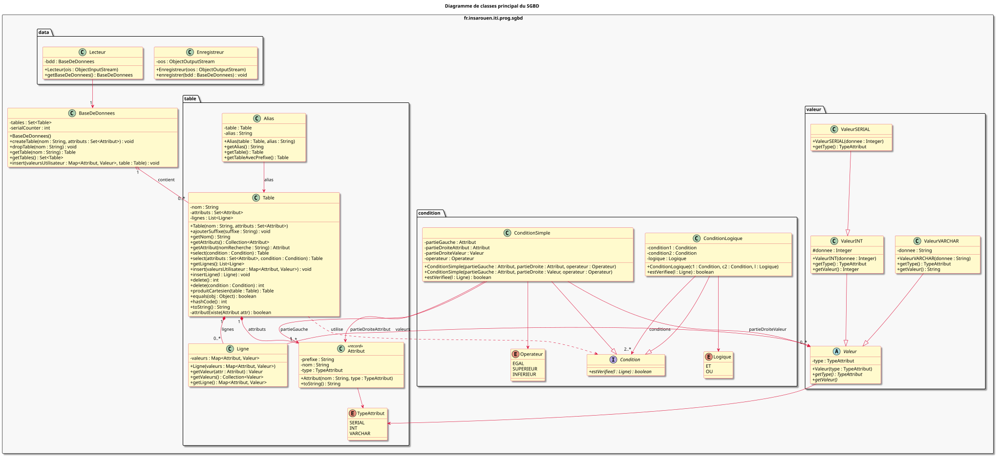

# Mini-SGBD — Un moteur de base de données SQL écrit en Java

Moteur de base de données relationnelle construit de zéro en **Java** : il lit des commandes SQL tapées au clavier, les analyse grâce à une grammaire **JavaCC**, les exécute et affiche les résultats sous forme de tableau. Les données sont sauvegardées entre deux sessions.

Projet de Programmation Orientée Objet réalisé en équipe de 5 à l'INSA Rouen Normandie (ITI3, 2025-2026).

📄 **[Lire le rapport du projet (PDF, 14 pages)](Rapport/Rapport_PI_SGBD.pdf)** : modélisation UML, choix de conception, analyseur JavaCC, persistance et répartition des tâches.

---

## Fonctionnalités

| Commande | Exemple |
|---|---|
| Créer une table | `CREATE TABLE livres (id SERIAL, titre VARCHAR, auteur_id INT);` |
| Insérer des lignes | `INSERT INTO livres (titre, auteur_id) VALUES ("Hamlet", 2);` |
| Lire une table | `SELECT * FROM livres;` |
| Filtrer | `SELECT titre FROM livres WHERE auteur_id = 1 OR auteur_id > 3;` |
| Joindre plusieurs tables | `SELECT a.nom, l.titre FROM auteurs AS a, livres AS l WHERE l.auteur_id = a.id;` |
| Supprimer des lignes | `DELETE FROM livres WHERE id = 3;` |
| Supprimer une table | `DROP TABLE livres;` |
| Lister les tables | `TABLES;` |
| Quitter (et sauvegarder) | `EXIT;` |

- **Types** : `INT`, `VARCHAR` et `SERIAL` (numéro qui s'incrémente tout seul).
- **Conditions** : `=`, `<`, `>`, combinées avec `AND` / `OR`.
- **Jointures** sur plusieurs tables, avec alias (`AS`) et auto-jointures (une table avec elle-même).
- **Gestion des erreurs** : table inconnue, colonne inconnue, table déjà existante, types incompatibles, mauvais nombre de valeurs… Le programme affiche un message clair au lieu de planter.
- **Sauvegarde** : la base est enregistrée dans un fichier à la sortie et rechargée au lancement suivant.

### Exemple

```
> SELECT auteurs.nom, livres.titre FROM auteurs, livres WHERE livres.auteur_id = auteurs.id;
| auteurs.nom         | livres.titre         |
|---------------------|----------------------|
| Victor Hugo         | Les Misérables       |
| Victor Hugo         | Notre-Dame de Paris  |
| William Shakespeare | Hamlet               |
| Molière             | Tartuffe             |
| Molière             | Le Malade Imaginaire |
```

---

## Conception

Le code est organisé en paquets, chacun avec une responsabilité précise :

| Paquet | Rôle |
|---|---|
| `analyseur` | Grammaire JavaCC qui transforme le texte SQL en appels Java |
| `table` | Tables, colonnes (attributs), lignes et alias |
| `valeur` | Valeurs typées (`ValeurINT`, `ValeurVARCHAR`, `ValeurSERIAL`) grâce à l'héritage |
| `condition` | Conditions du `WHERE` : conditions simples et combinaisons `AND` / `OR` (patron *Composite*) |
| `data` | Sauvegarde et chargement de la base (sérialisation Java) |
| `exception` | Hiérarchie d'exceptions propres au SGBD |



Les autres diagrammes UML (cas d'utilisation, modèle conceptuel, exceptions) sont dans le dossier [`diagramme/`](diagramme/). Les choix de conception sont expliqués en détail dans le [rapport](Rapport/Rapport_PI_SGBD.pdf).

---

## Lancer le projet

**Prérequis :** Java (JDK 17 ou plus), [JavaCC](https://javacc.github.io/javacc/) et, pour les tests, JUnit 4.

```bash
cd code
make compil      # génère l'analyseur avec JavaCC puis compile le code
java -cp classes fr.insarouen.iti.prog.sgbd.Main
```

On peut aussi exécuter un script SQL complet :

```bash
java -cp classes fr.insarouen.iti.prog.sgbd.Main < scriptstests/test_jointure.sql
```

### Tests

37 tests unitaires **JUnit** couvrent les valeurs, les conditions, les tables et la base de données :

```bash
make test        # compile les tests
make run         # lance les tests
```

Le dossier `code/scriptstests/` contient aussi des scripts SQL de démonstration (jointures, suppression, gestion des erreurs…).

---

## Équipe

Hadi Assi, Albin Pissot, Adam Araoud, Alioune Diallo et Noam Pacini-Martins.

---

## Ce que j'ai appris

- Concevoir une application orientée objet complète : héritage, classes abstraites, interfaces, patron Composite.
- Écrire une grammaire et générer un analyseur syntaxique avec JavaCC.
- Modéliser en UML avant de coder (PlantUML).
- Tester le code avec JUnit et gérer proprement les erreurs avec des exceptions.
- Travailler en équipe avec Git.
